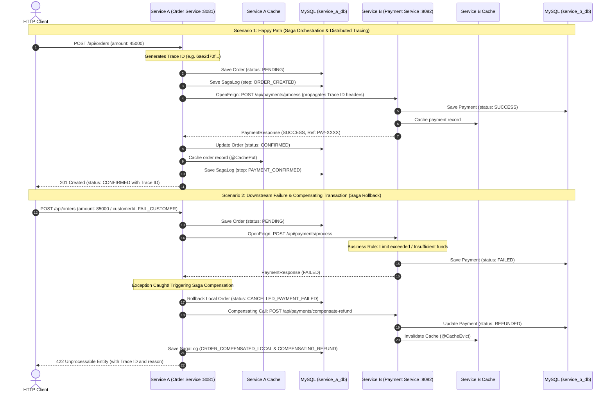

# Spring Boot Microservices: Service-to-Service Architecture

A production-grade implementation of two Spring Boot microservices (**Service A: Order Service** and **Service B: Payment Service**) demonstrating:
- **Synchronous Inter-Service Communication** via Spring Cloud OpenFeign
- **Distributed Transactions** using the **Saga Pattern** (Orchestration-based)
- **Compensating Transactions** for automatic downstream failure rollbacks (Eventual Consistency)
- **Distributed Tracing & Correlation IDs** (Trace ID & Span ID) using Micrometer Tracing and Brave
- **Caching Techniques** (`@Cacheable`, `@CachePut`, `@CacheEvict`)
- **Exception Catching & Handling** (`@RestControllerAdvice`, `FeignException`, custom business exceptions)
- **MySQL Integration** (`service_a_db` and `service_b_db`)

---

## 1. System Overview & Configuration

| Parameter | Service A (Order Service) | Service B (Payment Service) |
|---|---|---|
| **Port** | `8081` | `8082` |
| **MySQL Database** | `service_a_db` | `service_b_db` |
| **Database Host & Port** | `localhost:3306` | `localhost:3306` |
| **User & Password** | `user: root`, `password: ` (blank) | `user: root`, `password: ` (blank) |
| **Communication Mechanism** | Spring Cloud OpenFeign (Synchronous) | REST Endpoints |
| **Distributed Transaction** | Saga Orchestrator (`OrderSagaOrchestrator`) | Compensating Transaction (`/compensate-refund`) |
| **Distributed Tracing** | Micrometer Tracing + Brave (`Trace ID` & `Span ID`) | Micrometer Tracing + Brave |
| **Caching** | Spring Cache (`@Cacheable`, `@CachePut`, `@CacheEvict`) | Spring Cache (`@Cacheable`, `@CacheEvict`) |

---

## 2. Architecture Sequence Diagram



---

## 3. Core Technical Concepts Implemented

### 1. Inter-Service Communication via Spring Cloud OpenFeign
* **Declarative REST Client:** Defined in [PaymentClient.java](file:///i:/ServiceToService/service-a/src/main/java/com/microservices/servicea/client/PaymentClient.java), eliminating manual HTTP client boilerplate.
* **Automatic Header Propagation:** `feign-micrometer` propagates the W3C `traceparent` and correlation headers across the network.

### 2. Distributed Transactions & Saga Pattern
* In a distributed system with separate databases, standard `@Transactional` cannot provide two-phase commit (2PC) guarantees without severe locking and performance degradation.
* **Orchestration-based Saga:** [OrderSagaOrchestrator.java](file:///i:/ServiceToService/service-a/src/main/java/com/microservices/servicea/saga/OrderSagaOrchestrator.java) manages the workflow state machine.
* **Compensating Transactions:** If any downstream step fails:
  1. Service A compensates its local order state to `CANCELLED_PAYMENT_FAILED`.
  2. Service A executes a reverse compensating action on Service B (`/api/payments/compensate-refund`), updating the payment status to `REFUNDED`.
  3. Every step is committed in isolated transactions (`Propagation.REQUIRES_NEW`) to guarantee **Eventual Consistency** and persistent audit trails.

### 3. Distributed Tracing (Trace ID & Span ID)
* Built using **Micrometer Tracing** and **Brave**.
* Logging level pattern configured as:
  ```properties
  logging.pattern.level=%5p [${spring.application.name:},%X{traceId:-},%X{spanId:-}]
  ```
* Every log line printed by Service A and Service B shares the exact same **Trace ID**, allowing seamless log aggregation and rapid diagnosis of failures.
* [TracingFilter.java](file:///i:/ServiceToService/service-a/src/main/java/com/microservices/servicea/config/TracingFilter.java) injects `X-Correlation-Id` and `X-Trace-Id` into HTTP response headers.

### 4. Caching Techniques
* Configured using `@EnableCaching` and `ConcurrentMapCacheManager`:
  - `@Cacheable(value = "orders", key = "#id")`: Initial request fetches from MySQL and populates cache; subsequent lookups resolve from in-memory cache in ~9 ms ([OrderService.java](file:///i:/ServiceToService/service-a/src/main/java/com/microservices/servicea/service/OrderService.java)).
  - `@CachePut(value = "orders", key = "#result.id")`: Synchronously updates the cache when the order state changes.
  - `@CacheEvict(value = "orders", key = "#id")`: Removes entries upon deletion or cancellation to prevent stale data.

### 5. Catching Techniques & Exception Handling
* [GlobalExceptionHandler.java](file:///i:/ServiceToService/service-a/src/main/java/com/microservices/servicea/exception/GlobalExceptionHandler.java) handles:
  - `PaymentFailedException` (HTTP 422 Unprocessable Entity)
  - `FeignException` (HTTP 502 Bad Gateway when downstream is unavailable)
  - `OrderNotFoundException` (HTTP 404 Not Found)
  - Generic `Exception` (HTTP 500 Internal Server Error)
  - All errors return structured JSON with the active **Trace ID**.

---

## 4. Directory Structure

```
i:/ServiceToService/
├── apache-maven-3.9.6/                 # Standalone portable Maven
├── README.md                           # Documentation
├── service-a/                          # Order Microservice (Port 8081)
│   ├── pom.xml
│   └── src/main/
│       ├── java/com/microservices/servicea/
│       │   ├── ServiceAApplication.java
│       │   ├── client/
│       │   │   └── PaymentClient.java          # Spring Cloud OpenFeign
│       │   ├── config/
│       │   │   ├── CacheConfig.java            # In-Memory Cache configuration
│       │   │   └── TracingFilter.java          # Trace ID & Correlation ID filter
│       │   ├── controller/
│       │   │   └── OrderController.java        # REST Controller
│       │   ├── dto/
│       │   │   ├── ApiResponse.java
│       │   │   ├── CreateOrderRequest.java
│       │   │   ├── PaymentRequest.java
│       │   │   └── PaymentResponse.java
│       │   ├── entity/
│       │   │   ├── OrderEntity.java            # JPA entity (orders table)
│       │   │   ├── OrderStatus.java            # Status Enum
│       │   │   └── SagaLog.java                # Saga audit log entity
│       │   ├── exception/
│       │   │   ├── GlobalExceptionHandler.java # Error catching
│       │   │   ├── OrderNotFoundException.java
│       │   │   └── PaymentFailedException.java
│       │   ├── repository/
│       │   │   ├── OrderRepository.java
│       │   │   └── SagaLogRepository.java
│       │   ├── saga/
│       │   │   └── OrderSagaOrchestrator.java  # Saga Orchestrator & Compensation
│       │   └── service/
│       │       └── OrderService.java           # @Cacheable, @CachePut, @CacheEvict
│       └── resources/
│           └── application.properties          # service_a_db configuration
└── service-b/                          # Payment Microservice (Port 8082)
    ├── pom.xml
    └── src/main/
        ├── java/com/microservices/serviceb/
        │   ├── ServiceBApplication.java
        │   ├── config/
        │   │   ├── CacheConfig.java
        │   │   └── TracingFilter.java
        │   ├── controller/
        │   │   └── PaymentController.java      # Process & Compensate Endpoints
        │   ├── dto/
        │   │   ├── ApiResponse.java
        │   │   ├── PaymentRequest.java
        │   │   └── PaymentResponse.java
        │   ├── entity/
        │   │   ├── PaymentEntity.java          # JPA entity (payments table)
        │   │   └── PaymentStatus.java          # SUCCESS, FAILED, REFUNDED
        │   ├── exception/
        │   │   └── GlobalExceptionHandler.java
        │   ├── repository/
        │   │   └── PaymentRepository.java
        │   └── service/
        │       └── PaymentService.java         # Payment logic & Compensate Refund
        └── resources/
            └── application.properties          # service_b_db configuration
```

---

## 5. How to Run

### Step 1: Start Service B (Payment Service :8082)
```powershell
cd i:\ServiceToService\service-b
..\apache-maven-3.9.6\bin\mvn.cmd clean package -DskipTests
java -jar target\service-b-1.0.0.jar
```

### Step 2: Start Service A (Order Service :8081)
```powershell
cd i:\ServiceToService\service-a
..\apache-maven-3.9.6\bin\mvn.cmd clean package -DskipTests
java -jar target\service-a-1.0.0.jar
```

---

## 6. Live API Verification Commands

### Test 1: Successful Order & Saga Flow (Happy Path)
```powershell
$body = @{
    customerId = "CUST-001"
    productId = "LAPTOP-PRO"
    amount = 45000.00
} | ConvertTo-Json

Invoke-RestMethod -Uri "http://localhost:8081/api/orders" -Method Post -ContentType "application/json" -Body $body | ConvertTo-Json -Depth 5
```
**Expected Outcome:**
* HTTP 201 Created
* Order status: `CONFIRMED`
* Service B creates a payment record with status `SUCCESS`.
* Both services log the exact same `traceId`.

---

### Test 2: In-Memory Caching Verification (`@Cacheable`)
```powershell
# First invocation: fetches from MySQL (service_a_db)
Measure-Command { Invoke-RestMethod -Uri "http://localhost:8081/api/orders/1" -Method Get }

# Second invocation: retrieved from in-memory cache (< 10 ms)
Measure-Command { Invoke-RestMethod -Uri "http://localhost:8081/api/orders/1" -Method Get }
```

---

### Test 3: Downstream Failure & Saga Compensating Transaction (Rollback)
```powershell
$failBody = @{
    customerId = "FAIL_CUSTOMER"
    productId = "HIGH-VAL-ITEM"
    amount = 85000.00
} | ConvertTo-Json

try {
    Invoke-RestMethod -Uri "http://localhost:8081/api/orders" -Method Post -ContentType "application/json" -Body $failBody
} catch {
    $_.Exception.Response.StatusCode
    $stream = $_.Exception.Response.GetResponseStream()
    (New-Object System.IO.StreamReader($stream)).ReadToEnd()
}
```
**Expected Outcome:**
* HTTP 422 Unprocessable Entity
* Service B rejects payment due to amount threshold / invalid customer.
* Service A catches the failure and triggers compensating transactions:
  - Local Order status set to `CANCELLED_PAYMENT_FAILED`.
  - Service B payment status updated to `REFUNDED`.
* Eventual consistency preserved.

---

### Test 4: Query Distributed Saga Audit Logs
```powershell
Invoke-RestMethod -Uri "http://localhost:8081/api/orders/3/saga-logs" -Method Get | ConvertTo-Json -Depth 5
```
Returns chronological audit steps (`ORDER_CREATED` -> `ORDER_COMPENSATED_LOCAL` -> `COMPENSATING_REFUND`) with step statuses and the active Trace ID.
